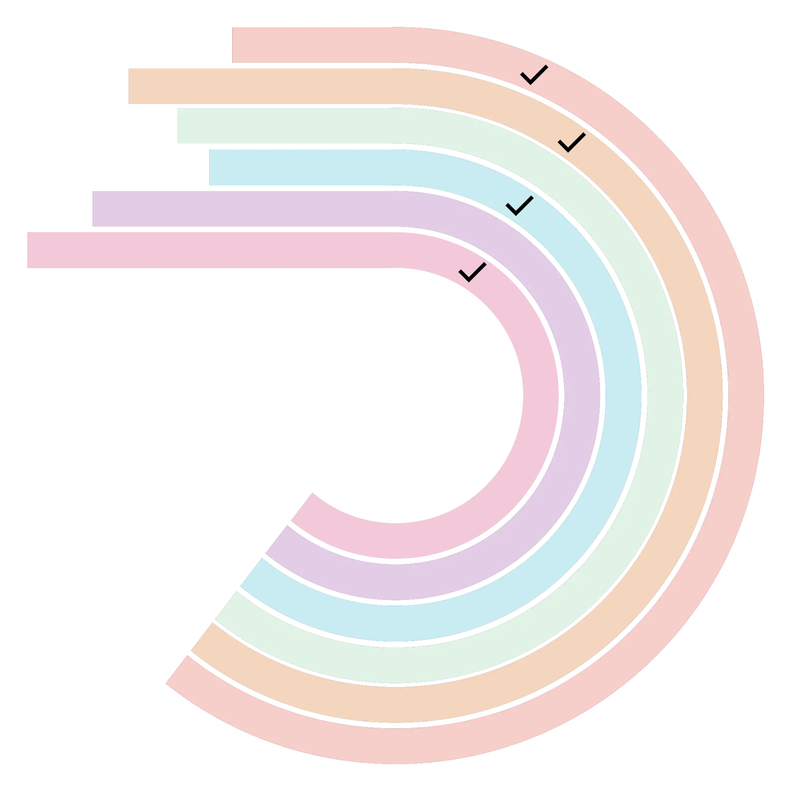
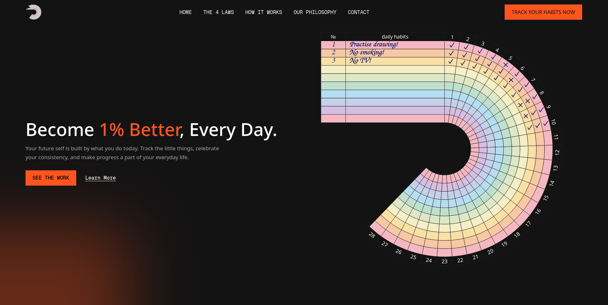
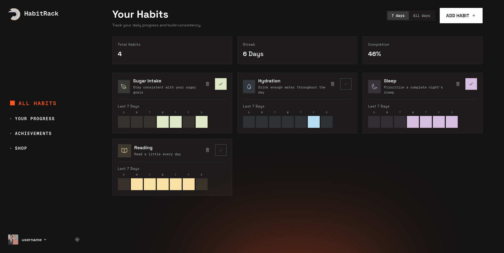

<div align="center"> 

# HabitRack

**A habit tracker built around one idea: small habits, tracked every day, add up.**

[Live demo](https://distorver.github.io/HabitRack/) · [Report a bug](https://github.com/Distorver/HabitRack/issues) · [Request a feature](https://github.com/Distorver/HabitRack/issues)

</div>

---

## Table of Contents

- [About](#about)
- [The Four Laws](#the-four-laws)
- [Features](#features)
- [Screenshots](#screenshots)
- [Tech Stack](#tech-stack)
- [Getting Started](#getting-started)
- [Project Structure](#project-structure)
- [Design System](#design-system)
- [Accessibility and Performance](#accessibility-and-performance)
- [Roadmap](#roadmap)
- [Contributing](#contributing)
- [Contact](#contact)

## About

HabitRack is a web app that helps people build habits and actually stick to them. It is inspired by _Atomic Habits_ by James Clear and turns the book's ideas into a simple daily workflow: define a habit, make it easy, track it, and see your progress over time.

The interface is minimal on purpose. No clutter, no noise. Just your habits and your streaks.

## The Four Laws

The product is organized around the four laws of behavior change from _Atomic Habits_. Each law maps to a part of how the app works:

| Law                       | Idea                                 | How HabitRack applies it                                  |
| ------------------------- | ------------------------------------ | --------------------------------------------------------- |
| **1. Make it obvious**    | Cues trigger habits                  | Clear habit list and daily view so nothing gets forgotten |
| **2. Make it attractive** | Habits you enjoy get repeated        | Clean visuals, streaks, and progress feedback             |
| **3. Make it easy**       | Reduce friction                      | Fast one-click check-ins                                  |
| **4. Make it satisfying** | Immediate reward reinforces behavior | Visible progress and achievements                         |

## Features

**Landing page**

- Hero section with an interactive ring tracker drawn in SVG
- The four laws of habit building, shown as a focusable list with a matching image
- "How it works" section with screenshots of the app
- Philosophy section and a contact form with client-side validation
- Text-decode hover effect on navigation links and custom eased scrolling
  **Habit dashboard**

- Create habits with a custom name, icon, color, and goal
- Boolean goals (done / not done) and numeric goals (for example `2L` or `30m`)
- One-click daily check-in, plus toggling past days
- Stats with a time filter (7 days by default)
- Remove habits you no longer need
  **Profile and settings**

- Editable profile with avatar upload
- Dark and light theme, remembered between visits
- Option to reset saved habits and profile
  **Auth pages**

- Login and sign-up screens with validation for name, email, and password (8+ characters)
- These are front-end only for now, with no server-side authentication
  **Persistence**

- Habits, profile, and theme are stored in `localStorage`

## Screenshots

<!-- Replace with real files from your assets folder -->

| Landing page                                        | Dashboard                                          |
| --------------------------------------------------- | -------------------------------------------------- |
|  |  |

## Tech Stack

- **HTML5**, **CSS3**, and **vanilla JavaScript** (modular, no framework)
- **Bootstrap 5.3.8** for layout utilities on the landing page
- **Ionicons 8.0.13** for habit icons
- **Google Fonts**: Space Grotesk and Geist Mono
- **Figma** for design and prototyping

## Getting Started

No installation or build step is needed.

```bash
# Clone the repository
git clone https://github.com/Distorver/HabitRack.git
cd HabitRack
```

Then open `index.html` in your browser.

For the best experience, serve it locally so paths resolve consistently:

```bash
# Python
python3 -m http.server 8000

# or Node
npx serve .
```

Open `http://localhost:8000`.

An internet connection is required for Bootstrap, Ionicons, and Google Fonts, which load from CDNs.

## Project Structure

```text
HabitRack/
├── index.html                # Landing page
├── pages/
│   ├── app/                  # habits, progress, achievements, shop
│   └── auth/                 # login, signup
├── css/
│   ├── base/                 # Shared tokens and global styles
│   ├── landing/              # One stylesheet per landing section
│   ├── app/                  # Dashboard, modal, stats, profile, cards
│   └── auth/                 # Login and signup styles
├── js/
│   ├── landing/              # Ring tracker, nav, scroll, section focus
│   ├── app/                  # data, habits, modal, profile modules
│   └── shared/               # Form validation
├── data/
│   └── habits.json           # Sample habit data
└── assets/
    └── images/
        ├── optimized/        # Web-ready images used by the site
        ├── source/           # Original screenshots and artwork
        └── svg/              # Vector graphics
```

The app logic is split into small modules (`Data`, `Habits`, `Modal`, `Profile`). `Data` owns storage and stats, and the other modules render and react to it.

## Design System

- **Style:** minimal, dark-first, with a single orange accent (`#fd551d`)
- **Typography:** Space Grotesk for text, Geist Mono for accents
- **Theming:** CSS custom properties on `:root`, with a `data-theme="light"` override
- **Structure:** one stylesheet per section or component, kept small and focused

## Accessibility and Performance

- Motion effects (text decode, custom scrolling) are skipped when the user prefers reduced motion
- Navigation links keep an `aria-label` with their original text during animation
- User-provided text is escaped before it is rendered
- Images used on the site are served from the `optimized/` folder (WebP where possible)

## Roadmap

- [ ] Progress page
- [ ] Achievements page
- [ ] Shop page
- [ ] Real authentication and cloud sync
- [ ] Reminders and notifications
- [ ] Data export

## Contributing

Contributions are welcome.

1. Fork the repository
2. Create a branch: `git checkout -b feature/your-feature`
3. Commit your changes: `git commit -m "Add your feature"`
4. Push the branch: `git push origin feature/your-feature`
5. Open a pull request

## Contact

- Mail: [ali.ayman.eid@proton.me](ali.ayman.eid@proton.me)
- LinkedIn: [linkedin.com/in/3li-ayman](https://linkedin.com/in/3li-ayman)

## Acknowledgments

- _Atomic Habits_ by James Clear, the inspiration behind the product philosophy
